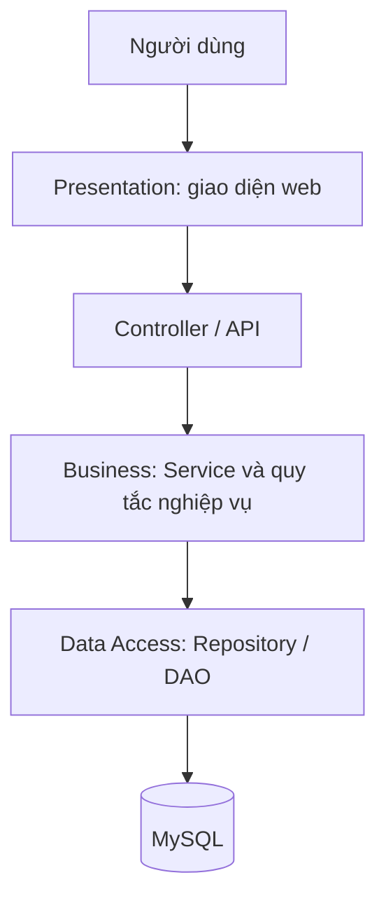

# Hệ thống quản lý gara và dịch vụ sửa chữa ô tô

Ứng dụng web quản lý tập trung quy trình tiếp nhận xe, báo giá, sửa chữa, kho phụ tùng, hóa đơn, thanh toán và bàn giao xe; hỗ trợ lịch sử sửa chữa, nhắc bảo dưỡng và báo cáo.

**Trạng thái:** Chỉ khởi tạo cấu trúc thư mục, chưa có mã nguồn, schema cơ sở dữ liệu hoặc ứng dụng chạy được. Các tệp `.gitkeep` rỗng giúp Git lưu thư mục chưa có nội dung.

## Tài liệu cơ sở

[Lab06 - Hệ thống quản lý gara và dịch vụ sửa chữa ô tô](<Lab06_LQQ_HỆ THỐNG QUẢN LÝ GARA VÀ DỊCH VỤ SỬA CHỮA Ô TÔ PDF.pdf>) gồm 90 trang:

| Phần | Nội dung | Trang |
| --- | --- | --- |
| Chương 1 | Phạm vi, vai trò, FR01–FR17, quy tắc nghiệp vụ | 9–19 |
| Chương 2 | Kiến trúc 3 lớp, Service, Repository, luồng xử lý | 20–32 |
| Chương 3 | ERD 23 bảng, từ điển dữ liệu, ràng buộc | 33–69 |
| Chương 4 | Năm nhóm giao diện UI-01–UI-05 | 70–82 |
| Chương 5 | Truy vết yêu cầu, tình huống kiểm thử, hướng phát triển | 83–89 |

Tên thư mục dưới đây là quy ước tổ chức đề xuất để hiện thực thiết kế trong PDF.

## Thành viên

| Họ và tên | MSSV |
| --- | --- |
| Trần Phạm Văn Quyến | 52400088 |
| Trần Vinh Quang | 52300248 |
| Phạm Huỳnh Tấn Lộc | 52300219 |

## Định hướng kỹ thuật và kiến trúc

- Ứng dụng web tổ chức theo kiến trúc 3 lớp trong cùng một ứng dụng.
- Ngôn ngữ định hướng: Python theo mục 2.6. Framework và phiên bản môi trường chưa được chốt.
- MySQL theo từ điển dữ liệu minh họa. Nếu chọn PostgreSQL cần đổi kiểu dữ liệu và cơ chế sinh khóa tương ứng.
- Tầng trình bày có thể tổ chức theo MVC. Các module nghiệp vụ không phải microservice độc lập.
- Nhà cung cấp thanh toán và kênh gửi email/SMS sẽ được lựa chọn khi triển khai.



Controller tiếp nhận yêu cầu và kiểm tra đầu vào cơ bản. Service kiểm tra quyền, xử lý nghiệp vụ, tính toán và điều phối giao dịch. Repository truy xuất dữ liệu; giao diện không truy vấn trực tiếp cơ sở dữ liệu. Ranh giới giao dịch nằm ở tầng nghiệp vụ.

## Cấu trúc thư mục

```text
GARAGE-AND-AUTOMOTIVE-REPAIR-SERVICE-MANAGEMENT-SYSTEM/
├── README.md
├── Lab06_LQQ_HỆ THỐNG QUẢN LÝ GARA VÀ DỊCH VỤ SỬA CHỮA Ô TÔ PDF.pdf
├── docs/
│   ├── requirements/              # Yêu cầu, use case, quy tắc nghiệp vụ
│   ├── architecture/              # Thiết kế kiến trúc, trách nhiệm các tầng
│   ├── diagrams/                  # UML, sơ đồ lớp và luồng xử lý
│   ├── database/                  # ERD và từ điển dữ liệu
│   ├── ui/                        # Wireframe UI-01 đến UI-05
│   ├── api/                       # Đặc tả API khi triển khai
│   └── testing/                   # Kế hoạch và tình huống kiểm thử
├── src/
│   └── garage/
│       ├── presentation/
│       │   ├── controllers/       # Nhận request và gọi Service
│       │   ├── validators/        # Kiểm tra đầu vào cơ bản
│       │   ├── templates/
│       │   │   ├── layouts/       # Bố cục dùng chung
│       │   │   ├── auth/          # UI-01: đăng ký, đăng nhập
│       │   │   ├── reception/     # UI-02: hồ sơ, xe, tiếp nhận, phân công
│       │   │   ├── repairs/       # UI-03: báo giá, tiến độ, lịch sử, lịch nhắc
│       │   │   ├── billing/       # UI-04: hóa đơn, thanh toán, công nợ
│       │   │   └── management/    # UI-05: kho, tài khoản, báo cáo, lịch nhắc
│       │   └── static/
│       │       ├── css/
│       │       ├── js/
│       │       └── images/        # Ảnh giao diện
│       ├── business/
│       │   ├── services/
│       │   │   ├── authentication/
│       │   │   ├── authorization/
│       │   │   ├── customer_vehicle/
│       │   │   ├── reception_quotation/
│       │   │   ├── repair_progress/
│       │   │   ├── inventory/
│       │   │   ├── billing_payment/
│       │   │   └── reporting/
│       │   ├── rules/             # Tính tiền, chuyển trạng thái, quy tắc nghiệp vụ
│       │   └── jobs/              # Tác vụ định kỳ, gồm nhắc bảo dưỡng
│       ├── data_access/
│       │   ├── models/            # Ánh xạ 23 bảng
│       │   ├── repositories/      # Truy vấn dữ liệu theo trách nhiệm
│       │   └── transactions/      # Hỗ trợ giao dịch do Service điều phối
│       ├── integrations/
│       │   ├── payments/          # Kết nối nhà cung cấp thanh toán
│       │   └── notifications/     # Kết nối kênh gửi thông báo
│       ├── config/                # Cấu hình ứng dụng và kết nối
│       └── common/                # Kiểu dữ liệu, lỗi, tiện ích dùng chung
├── database/
│   ├── schema/                    # Định nghĩa bảng và ràng buộc
│   ├── migrations/                # Các phiên bản thay đổi dữ liệu
│   └── seeds/                     # Danh mục và dữ liệu minh họa
├── tests/
│   ├── unit/                      # Quy tắc và Service
│   ├── integration/               # Repository, giao dịch, tích hợp
│   ├── e2e/                       # Quy trình từ tiếp nhận đến bàn giao
│   └── fixtures/                  # Dữ liệu kiểm thử dùng chung
├── storage/
│   └── uploads/
│       ├── receptions/            # Ảnh hiện trạng khi tiếp nhận
│       └── repairs/               # Ảnh minh chứng sửa chữa
└── scripts/                       # Công cụ hỗ trợ phát triển khi cần
```

`docs/database/` lưu tài liệu thiết kế; `database/` dành cho tệp cơ sở dữ liệu thực thi về sau. `storage/uploads/` dành cho ảnh nghiệp vụ có kiểm soát truy cập; ảnh giao diện nằm trong `static/images/`. Hiện các thư mục chỉ có tệp giữ chỗ.

`reception_quotation/` hiện thực nhóm Reception & Vehicle Service trong PDF. `customer_vehicle/` phụ trách hồ sơ, xe, lịch sử và lịch nhắc; tác vụ gửi nhắc định kỳ nằm trong `jobs/`. `integrations/` chứa bộ kết nối bên ngoài do Service sử dụng.

## Vai trò người dùng

| Vai trò | Mã | Phạm vi chính |
| --- | --- | --- |
| Khách hàng | `CUSTOMER` | Hồ sơ và xe của mình, duyệt báo giá, thanh toán, lịch sử, lịch nhắc |
| Lễ tân / Cố vấn dịch vụ | `RECEPTIONIST` | Tiếp nhận, phân công, báo giá, hóa đơn, xác minh khoản thu theo quyền |
| Kỹ thuật viên | `TECHNICIAN` | Công việc được giao, tiến độ, ảnh minh chứng, yêu cầu phụ tùng |
| Quản lý kho | `STOREKEEPER` | Danh mục, nhập xuất kho, tồn và cảnh báo |
| Chủ gara / Quản lý | `MANAGER` | Tài khoản, phân quyền, phê duyệt và báo cáo |

Khách hàng tự đăng ký chỉ nhận vai trò khách hàng; tài khoản nhân viên do quản lý cấp. Máy chủ kiểm tra cả vai trò và quyền sở hữu dữ liệu.

## Phạm vi chức năng

| Yêu cầu | Chức năng | Module nghiệp vụ chính |
| --- | --- | --- |
| FR01 | Đăng ký khách hàng, đăng nhập theo vai trò | `authentication`, `authorization` |
| FR02 | Hồ sơ khách hàng và xe | `customer_vehicle` |
| FR03 | Tiếp nhận xe | `reception_quotation` |
| FR04 | Ghi nhận tình trạng xe và ảnh ban đầu | `reception_quotation` |
| FR05 | Lập báo giá sửa chữa | `reception_quotation` |
| FR06 | Khách hàng xác nhận báo giá | `reception_quotation` |
| FR07 | Phân công kỹ thuật viên | `reception_quotation` |
| FR08 | Cập nhật tiến độ sửa chữa | `repair_progress` |
| FR09 | Danh mục phụ tùng, nhập cơ bản và tồn kho | `inventory` |
| FR10 | Xuất kho cho phiếu sửa chữa | `inventory` |
| FR11 | Cảnh báo tồn thấp | `inventory` |
| FR12 | Tính tổng chi phí sửa chữa | `billing_payment` |
| FR13 | Lập hóa đơn | `billing_payment` |
| FR14 | Thanh toán tiền mặt, chuyển khoản, online | `billing_payment` |
| FR15 | Tra cứu lịch sử sửa chữa | `customer_vehicle` |
| FR16 | Nhắc bảo dưỡng theo ngày hoặc số km | `customer_vehicle`, `jobs` |
| FR17 | Báo cáo doanh thu, hiệu suất kỹ thuật viên | `reporting` |

Danh mục dịch vụ, đơn giá và khuyến mãi được quản lý theo quyền để phục vụ báo giá và hóa đơn.

## Thiết kế dữ liệu

Theo Chương 3, hệ thống có **23 bảng**:

| Nhóm | Các bảng |
| --- | --- |
| Tài khoản và hồ sơ | `Users`, `Employees`, `Customers`, `Vehicles` |
| Tiếp nhận và ảnh | `Receptions`, `EvidenceImages` |
| Danh mục và báo giá | `Services`, `Parts`, `Quotations`, `QuoteItems` |
| Sửa chữa và phân công | `RepairOrders`, `Assignments`, `RepairTasks`, `RepairUpdates` |
| Nhập và xuất kho | `StockReceipts`, `ReceiptItems`, `StockIssues`, `IssueItems` |
| Hóa đơn và thanh toán | `Invoices`, `InvoiceItems`, `Payments` |
| Nhắc lịch và nhật ký | `Reminders`, `AuditLogs` |

Mỗi phiếu tiếp nhận sinh tối đa một phiếu sửa chữa; mỗi phiếu sửa chữa có tối đa một hóa đơn. Một hóa đơn có thể có nhiều giao dịch thanh toán. Các vai trò nhân viên dùng `Users.role`, không tạo bảng riêng cho từng vai trò.

## Quy trình và quy tắc nghiệp vụ

1. Tra cứu hoặc tạo hồ sơ khách hàng và xe trước khi tiếp nhận. Lưu số km, mức nhiên liệu, tình trạng và ảnh ban đầu.
2. Tạo phiếu sửa chữa, phân công kỹ thuật viên khả dụng; nếu chưa có người thì lưu hàng chờ, không ép trùng lịch.
3. Báo giá giữ nguyên đơn giá đã chốt. Chỉ sửa chữa khi có phân công hợp lệ và khách hàng đã duyệt báo giá. Phát sinh cần báo giá bổ sung được duyệt trước khi thực hiện.
4. Nhập xuất kho cập nhật chứng từ cùng tồn kho trong một giao dịch, đúng một lần. Không xuất vượt yêu cầu, tồn thực tế hoặc lượng còn được duyệt. Báo giá và lập hóa đơn không làm giảm tồn kho.
5. Tiến độ công việc: `WAITING → IN_PROGRESS`, `IN_PROGRESS ↔ PAUSED`, `IN_PROGRESS → COMPLETED`. Chỉ hoàn tất phiếu khi tất cả hạng mục bắt buộc đã xong.
6. Hóa đơn lấy tiền công đã hoàn thành và phụ tùng thực xuất hợp lệ theo giá được duyệt. Thành tiền từng dòng làm tròn đến đồng; khuyến mãi là số tiền giảm đã xác nhận, không vượt tổng trước giảm.
7. Chỉ giao dịch `SUCCESS` làm tăng tiền đã thu. Máy chủ xác minh phản hồi thanh toán và chống xử lý lặp; cập nhật khoản thu và hóa đơn trong cùng giao dịch.
8. Chỉ bàn giao khi phiếu sửa chữa `COMPLETED` và hóa đơn `PAID`. Điều chỉnh quan trọng cần phê duyệt theo quyền và nhật ký.

Tiền dùng `DECIMAL(15,2)`, số lượng vật tư dùng `DECIMAL(12,3)` theo tài liệu; không dùng số thực dấu phẩy động để tính tiền.

```text
Tổng hóa đơn = Tiền công + Tiền phụ tùng - Khuyến mãi đã duyệt
Tiền đã thu  = Tổng số tiền giao dịch SUCCESS của hóa đơn
Số dư       = Tổng hóa đơn - Tiền đã thu
```

Trạng thái hóa đơn: `UNPAID`, `PARTIALLY_PAID`, `PAID`, `CANCELLED`. Trạng thái giao dịch: `PENDING`, `SUCCESS`, `FAILED`, `CANCELLED`. Hóa đơn 0 đồng cần quản lý xác nhận, không tạo giao dịch 0 đồng. Phản hồi muộn gây thu vượt phải được đối soát.

## Hướng triển khai tiếp theo

1. Thống nhất framework Python, phiên bản môi trường và thư viện truy xuất MySQL.
2. Hiện thực schema 23 bảng, ràng buộc, migration và dữ liệu minh họa theo PDF.
3. Xây dựng xác thực, phân quyền, hồ sơ, tiếp nhận, báo giá, phân công và tiến độ.
4. Hoàn thiện giao dịch kho, hóa đơn, thu tiền và nhật ký.
5. Tích hợp thanh toán, gửi nhắc, đối soát và kiểm soát tác vụ lặp.
6. Hoàn thiện báo cáo, kiểm thử đồng thời, sao lưu và phục hồi trước vận hành.

Kiểm thử trọng tâm: quyền sở hữu dữ liệu, kỹ thuật viên bận, xuất kho đồng thời, thanh toán nhiều lần, phản hồi trùng và điều kiện bàn giao. Tình huống mẫu trang 87 có hóa đơn 1.100.000 đồng: thu thành công 600.000 đồng thì còn 500.000 đồng; giao dịch chờ hoặc thất bại không cộng vào tiền đã thu.

**Chưa có lệnh cài đặt, chạy ứng dụng hoặc chạy kiểm thử**, vì hiện chỉ có cấu trúc thư mục. Hướng dẫn sẽ được bổ sung khi có mã nguồn và cấu hình phụ thuộc.

## Ngoài phạm vi ban đầu

Mua hàng và nhập kho chuyên sâu, quản lý nhà cung cấp, lương/chấm công, kế toán tổng hợp, ứng dụng di động riêng và tối ưu lịch tự động chưa thuộc phạm vi ban đầu. Thuế, hóa đơn điện tử, hoàn tiền và thay thế hóa đơn cần thiết kế quy trình bổ sung trước khi triển khai.
